<div align="center">


# Coclico

### Maintain, tune and equip your Windows PC - with confidence
[](https://dotnet.microsoft.com/)
[](#requirements)
[](LICENSE.txt)
[](https://github.com/Coclico-cy/Coclico/releases)

**English** · [Français](README_FR.md) · [Developer (EN)](READMEDEV.md) · [Developer (FR)](READMEDEV_FR.md)

</div>

---

## What is Coclico for?

Coclico is a free and open-source Windows application. It brings together, in one modern interface, the tools a PC needs every day:

- **Clean** Windows and reclaim disk space;
- **Repair** and diagnose common problems;
- **Tune** memory, network and power;
- **Install** your favorite software in a few clicks.

Every action explains what it does. Every destructive action asks for confirmation. You always understand what is about to happen before it happens.

> **A solo project, and a living one.** Coclico is developed by a single person, in their free time. Updates may be spaced out depending on available time. No worries: the project is very much alive and keeps evolving.

## AI assistance disclosure

I created and maintain Coclico on my own. I use AI transparently as a helper: to correct and structure my texts in both French and English (I live with dyslexia and dysorthographia), to hunt bugs, and to better grasp technical topics such as .NET 10. AI suggestions may have informed code changes. I review and take responsibility for everything integrated into the project. Coclico is therefore not a project "made without AI", and I prefer to state it clearly.

## Getting started

A welcome message introduces the application on first launch:

<p align="center">
  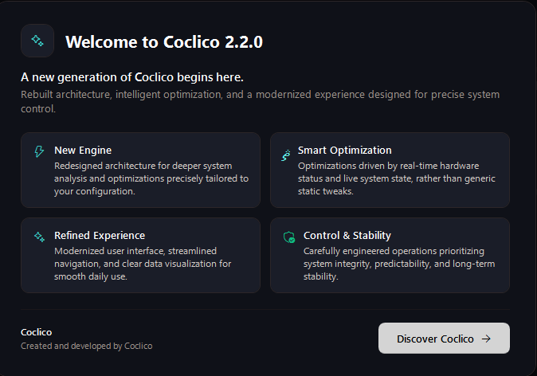
</p>

Coclico starts as a standard user. Tools that need administrator rights ask for them exactly when needed never at launch.

The main menu is a grouped accordion, inspired by Windows Settings. Modules live in three collapsible sections that remember what you expanded:

<p align="center">
  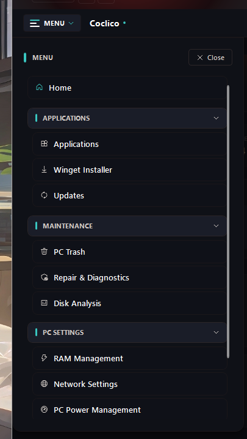
</p>

| Section | Modules |
| --- | --- |
| **MAINTENANCE** | PC Trash · Repair & Diagnostics · Disk Analysis |
| **PC SETTINGS** | RAM Management · Network Settings · PC Power Management |
| **APPLICATIONS** | Programs · Winget Installer |

Home, Settings and Help always stay visible.

| | |
| --- | --- |
| **Safety first** | Every destructive action asks for confirmation. Deleted files go to the Recycle Bin. Network and power settings roll back in one click. |
| **Hardware aware** | Power plans are created only through `powercfg`. Every setting is validated against your actual PC before it is applied. |
| **Local AI** | A local GGUF model or a local Ollama server. No cloud keys. Loopback addresses only. |
| **Verified installs** | Every payload file is hashed into a manifest signed with an RSA-4096 key; the installer refuses anything that does not verify against the trusted keys anchored in the repository. |

## The modules, one by one

### Home - your PC at a glance

<p align="center">
  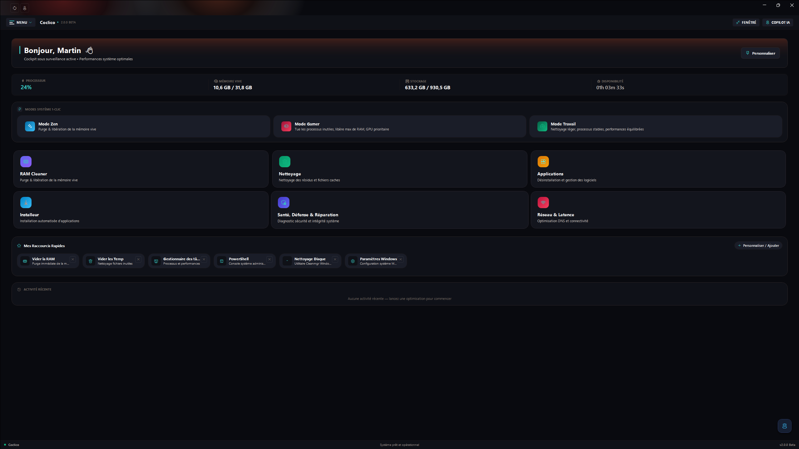
</p>

The home screen shows CPU, memory and disks live. Three one-click modes combine memory cleaning and temp file cleanup:

- **Zen**: quick memory cleanup plus temporary files, for a light PC again.
- **Gamer**: deep memory purge before a gaming session.
- **Work**: standard memory cleanup, without touching files.

Tiles are customizable: choose which shortcuts appear on your home screen, and add your own.

### PC Trash - clean without risk

<p align="center">
  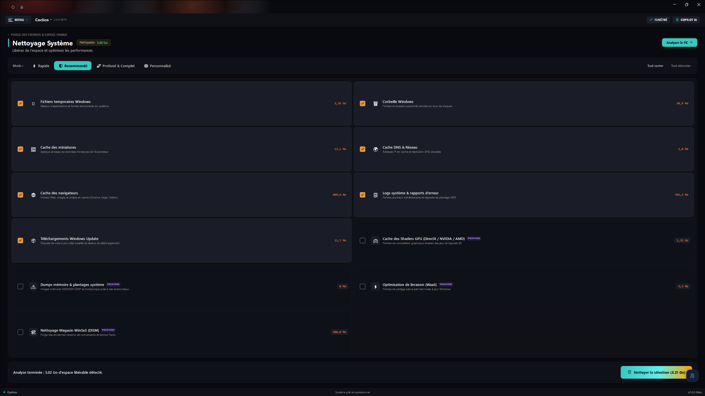
</p>

The module scans first, deletes second, and always with your confirmation. Covered categories:

- Windows temporary files;
- Recycle Bin;
- Thumbnail cache;
- Browser caches;
- System logs;
- DNS cache flush.

Presets select a whole set of categories in one click (quick or full cleanup). After each run, a summary reports the space freed and the number of files removed.

### Repair & Diagnostics - Windows in full health

<p align="center">
  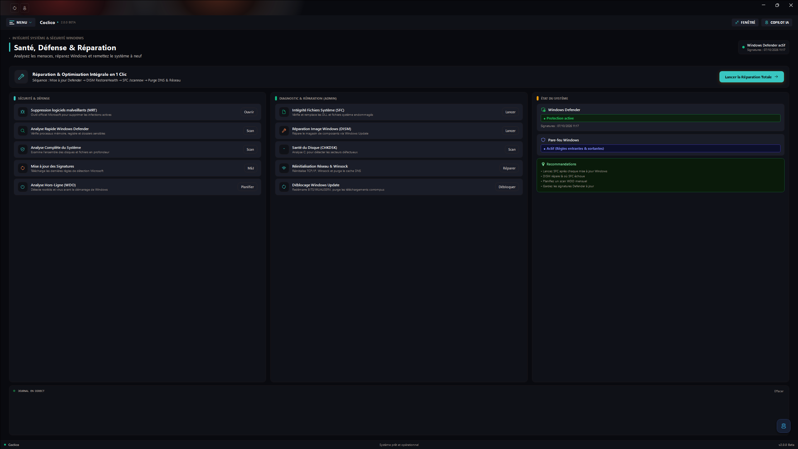
</p>

One central place for the health of Windows:

- Windows Defender status and signature freshness;
- **One-click fix**: a guided sequence of checks and repairs, step by step, with cancellation at any time;
- Defender quick scan and full scan;
- Signature updates;
- Access to the Malicious Software Removal Tool (MSRT) and Defender's offline scan (WDO);
- Windows startup health check.

### Disk Analysis - where does your space go?

<p align="center">
  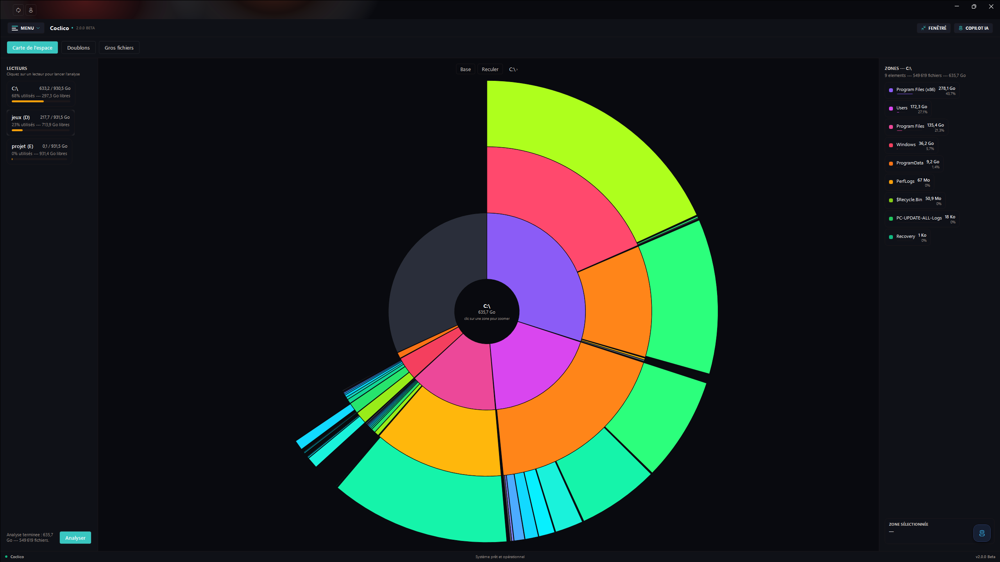
</p>

Three complementary modes:

- **Space map**: an interactive radial map of any drive or folder. Click a zone to zoom in. Go back with the breadcrumb. Open any location in Explorer.
- **Duplicates**: the search runs in three phases (size, then a hash of the first 64 KB, then a full SHA-256 fingerprint). Only files with *identical content* are listed. Threshold of 1 to 100 MB. Deletion **to the Recycle Bin**, with confirmation.
- **Largest files**: the top 50, 100 or 200 biggest files in a folder, with an "open location" option and per-file deletion to the Recycle Bin.

### RAM Management - memory in top shape

<p align="center">
  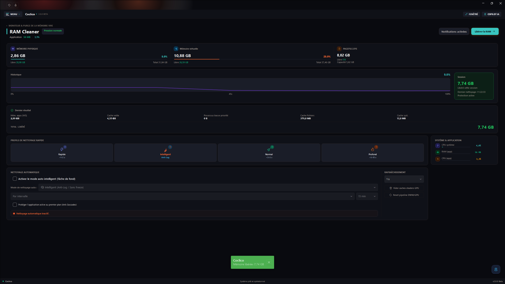
</p>

- Live view of physical memory, virtual memory (commit) and the page file (free / total);
- Manual purge with several profiles: quick, normal, deep, smart;
- History and total memory freed since the session started;
- **Smart automatic cleaning**: by interval, by usage threshold, or hybrid. The foreground application is protected: Coclico never purges what you are currently using.
- **How this works, honestly**: purging asks Windows to trim the working sets of background processes (the foreground app is protected). Windows manages memory on its own: freed RAM is not a speed gain in itself, and trimmed pages can be reloaded when you reopen an app. Use it to release memory pressure before a game or a heavy task — not as a magic booster.

### Network Settings - nine useful settings, zero placebo

<p align="center">
  
</p>

Nine network parameters, all documented by Microsoft. The module **never** writes to the registry: it uses Windows' official tools (`netsh` for TCP, PowerShell for the network adapter).

- **TCP stack** (5 settings): autotuning, scaling heuristics, ECN, timestamps, RSS;
- **Network adapter** (4 settings): adapter power management, EEE (green ethernet), flow control, interrupt moderation.

Key points:

- A setting your adapter does not support shows "--" and is skipped. Coclico does not pretend;
- A test measures throughput and latency **before and after** the changes;
- Restore puts back the **real Windows defaults** in one click;
- The network adapter is displayed live: status, ping, throughput.

### PC Power Management - three honest plans

<p align="center">
  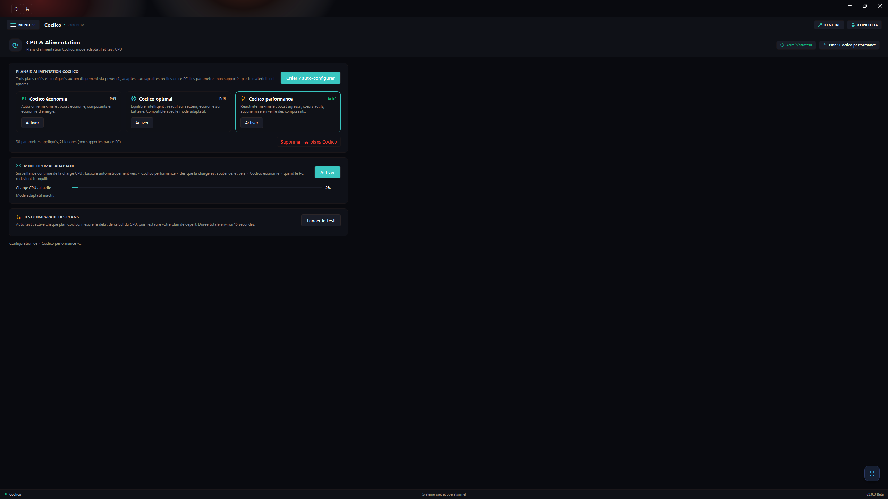
</p>

Three Coclico power plans, created and driven **only through `powercfg`** (no direct registry writes):

- **Coclico economie**: maximum battery life. Efficient boost, components in power-saving mode.
- **Coclico optimal**: responsive on AC power, frugal on battery. The display turns off normally. Compatible with the adaptive mode.
- **Coclico performance**: maximum responsiveness. Aggressive boost, active cores, no component sleep but the battery is respected: the CPU can downshift and energy efficiency stays active on battery.

Key points of the module:

- **Auto-configured for your PC**: every setting is validated with `powercfg /q` before being applied. What your hardware does not support is skipped and counted you see exactly what was applied;
- **Adaptive mode**: Coclico watches CPU load and switches on its own to "performance" under sustained load, back to "economie" when the PC is idle again. The mode re-syncs with the actually active plan;
- **Comparative test**: measures the CPU under each of the three plans (about 15 seconds), shows the results as bars and **restores your starting plan** even if it is not a Coclico plan. The result is indicative: a load test favors by construction the most power-hungry plan;
- The Coclico plans can be deleted at any time. Coclico then returns to the Windows Balanced plan. Administrator rights required.

### Programs - your software list, made clear

<p align="center">
  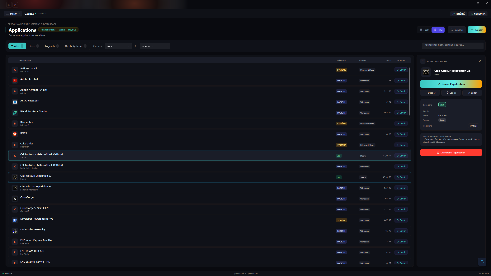
</p>

- Inventory of installed applications: scan, instant search, category filters, sorting;
- Per-application details: size, version, install path;
- Clean uninstall through each application's own uninstaller, with confirmation;
- Add missing programs to the list.

### Winget Installer - your software in one click

<p align="center">
  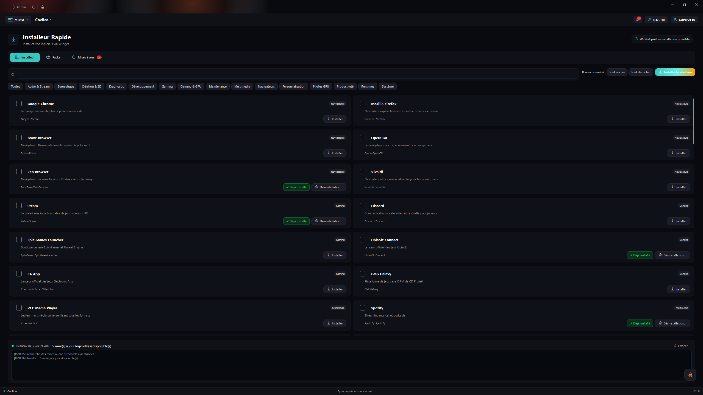
</p>

A catalog of more than 70 popular applications, installable in one click through **Winget**. The button reads "Already installed" when the software is present on your machine. Software missing from Winget is downloaded from its official GitHub repository.

To go faster, **thematic packs** install a complete set at once:

<p align="center">
  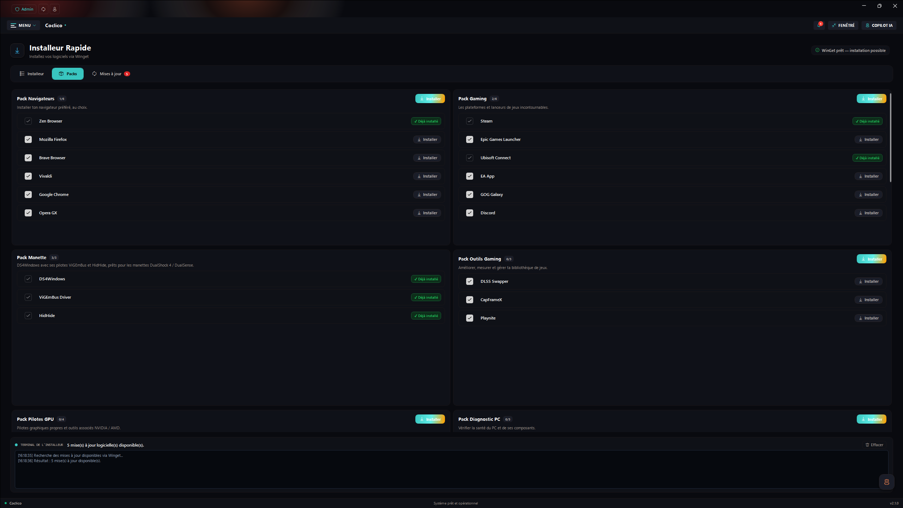
</p>

Some available packs: Gaming Pack, Controller Pack, GPU Drivers Pack, Browsers Pack, PC Diagnostics Pack, Developer Pack, New PC Pack, Media & Creation Pack, Audio & Stream Pack, Runtimes Pack…

**Example: play with a controller outside Steam.** The Controller Pack sets up everything for a DualShock 4 or a DualSense:

1. **DS4Windows**: the software that configures the controller (vibration, gyroscope, per-game profiles). Downloaded from its official GitHub repository.
2. **ViGEmBus**: the virtual controller driver. It makes Windows believe an Xbox controller is plugged in. (Upstream project retired by its author in 2023: still functional, but no longer updated.)
3. **HidHide**: hides the physical controller. Without it, some games see the controller twice.

One click, and all three are installed in the right order. The same principle applies to every pack.

The installer also handles **updates**: outdated software is offered an update, and Coclico updates itself from GitHub.

<p align="center">
  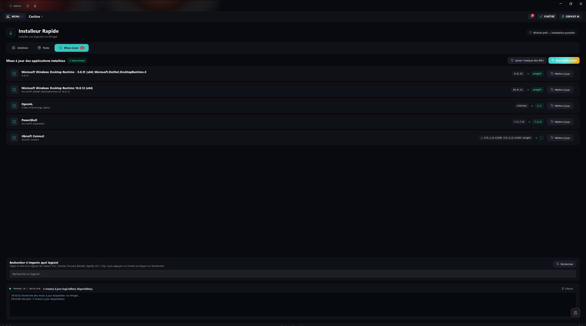
</p>

### Local AI assistant - a helping hand, no cloud

<p align="center">
  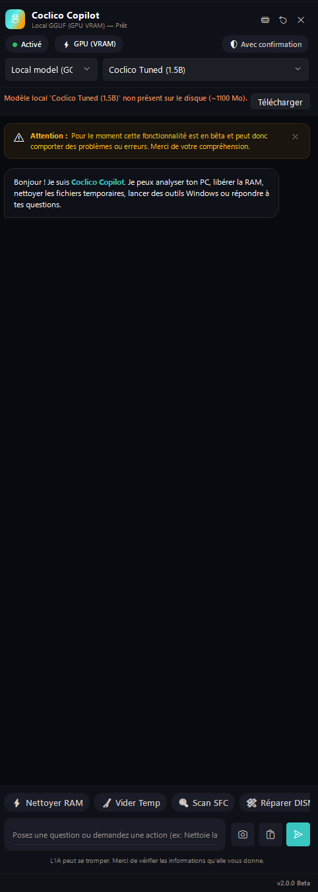
</p>

A built-in assistant, **100% local**, available from any module through the floating button or `Ctrl + Space`:

- Two engines to choose from: a **GGUF** model run by LLamaSharp (optional NVIDIA GPU acceleration, automatic CPU fallback), or a local **Ollama** server (`localhost` addresses only);
- Attach images (vision);
- The assistant knows which module you are on. It can propose **Coclico actions**: every action is shown and confirmed before it runs;
- No cloud API keys. Cloud providers have been removed from the project.

### Notifications - a record of what Coclico did

<p align="center">
  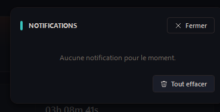
</p>

One panel gathers the application's notifications. You see what was done and when, and you can clear everything in one click. Nothing happens silently.

## Set up a new PC in ten minutes

A concrete example of what Coclico can do on a brand-new machine:

1. **Equip**: Winget Installer → New PC Pack (7-Zip, PowerToys, WizTree…), then Gaming Pack or Developer Pack depending on your use.
2. **Plug the controller**: Winget Installer → Controller Pack (DS4Windows + drivers).
3. **Start clean**: PC Trash → quick preset.
4. **Tune the network**: Network Settings → before/after test, then apply.
5. **Tune power**: PC Power Management → Coclico optimal plan, with the adaptive mode.

## Local AI and privacy

Coclico does not ask for, store or use any third-party AI API key. On the first launch of this version, Coclico even removes the legacy encrypted API-key vault if it still exists.

Downloading a GGUF model requires internet access once. Inference then runs locally. Your prompts and images are sent only to the selected local engine. Coclico reaches the network for specific functions: GitHub update checks, model and software downloads.

Review the assistant's proposals before letting it change your system. AI output can be incorrect: it does not replace your judgment or the Windows documentation.

## Requirements

- Windows 11, version 22H2 or later (build 22621 or later).
- No separate .NET installation required: the .NET 10 Desktop Runtime is included in the installer and the portable archive.
- Internet access for updates and the first AI model download. A previously downloaded model runs offline.
- Optional: Ollama installed and running locally.
- Optional: a compatible NVIDIA GPU and the CUDA 12 runtime for GPU acceleration. The CPU works as a fallback.
- Enough memory and disk space for the AI model you choose. GGUF files are large and are not included in this repository.
- Some modules (power, installer, parts of cleaning) require administrator rights.

## Get Coclico

Open the [GitHub Releases](https://github.com/Coclico-cy/Coclico/releases) page:

- `Coclico-<version>.exe`: the guided installer;
- or the Windows x64 ZIP: for a portable folder install.

Setup installs for the current Windows account, offers an optional desktop shortcut, and preserves Coclico settings and data when uninstalled. The standard setup omits the large optional CUDA runtime: choose that component only on a compatible NVIDIA system. The installer binary carries no Authenticode signature, so Windows may show a publisher warning; integrity is still cryptographic: each payload file is hashed into a manifest signed with the project RSA-4096 key, and the installer verifies that manifest against the trusted keys anchored in the repository before installing anything.

Every release ships a `SHA256SUMS.txt` file to verify both downloads.

## Keyboard shortcuts and tray

| Shortcut | Action |
| --- | --- |
| `F11` | Toggle full screen / windowed |
| `Ctrl` + `Space` | Open or close the AI assistant panel |

Coclico can also minimize to the notification area (enable it in Settings). Right-clicking the tray icon restores the window.

## Build it yourself

Install the .NET 10 SDK on Windows, then:

```powershell
dotnet restore Coclico.slnx
dotnet build Coclico.slnx --configuration Release --no-restore
dotnet test Coclico.slnx --configuration Release --no-build --no-restore
```

Full details (architecture, installer pipeline, CI) live in the [developer documentation](READMEDEV.md).

## Safety notes

- Some operations delete files or change Windows. Check the selected categories and read the result summary.
- Network and power settings depend on your adapter and hardware. That is what the restore features are for. Keep another way to restore connectivity.
- Coclico never writes directly to the registry for network (`netsh` / PowerShell) or power (`powercfg`).
- Keep your important data backed up. Coclico is not a replacement for Windows recovery tools or a real backup.
- To report an issue: include your Windows version, your Coclico version and the steps to reproduce. Never send passwords, API keys or personal files.

## Project structure

```text
Coclico/                 WPF application
  Common/                Shared services (core, diagnostics, execution, UI)
  Modules/               Home, AI, cleaning, network, power, disk, programs…
  Resources/             Themes, languages and icons
  Security/              trust-policy.json: anchored release signing keys
Coclico.Security/        Release security: signing tool, integrity manifests, trust store
Coclico.InstallerAot/    Standalone installer (Avalonia, NativeAOT)
Coclico.Tests/           Unit, XAML and security tests
installer/               Installer build script and local signing key (never committed)
docs/                    Screenshots used by the READMEs
.github/workflows/       Build, test and release automation
```

## License

The project is licensed under the MIT License. You may use, copy, modify and redistribute it, provided you include the copyright and license notice. See [LICENSE.txt](LICENSE.txt). Third-party dependencies may have their own licenses.
