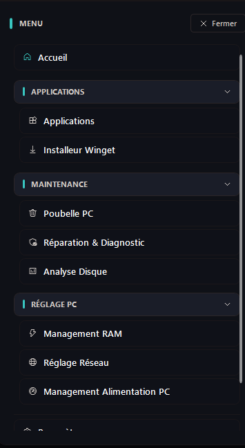

<div align="center">


# Coclico

### Entretenir, régler et équiper son PC Windows - en confiance
[](https://dotnet.microsoft.com/)
[](#configuration-requise)
[](LICENSE.txt)
[](https://github.com/Coclico-cy/Coclico/releases)

[English](README.md) · **Français** · [Dev (EN)](READMEDEV.md) · [Dev (FR)](READMEDEV_FR.md)

</div>

---

## À quoi ça sert ?

Coclico est une application Windows gratuite et open source. Elle réunit, dans une seule interface moderne, les outils dont un PC a besoin au quotidien :

- **Nettoyer** Windows et retrouver de l'espace disque ;
- **Réparer** et diagnostiquer les problèmes courants ;
- **Régler** la mémoire, le réseau et l'alimentation ;
- **Installer** tes logiciels préférés en quelques clics.

Chaque action explique ce qu'elle fait. Chaque action destructive demande une confirmation. Tu comprends toujours ce qui va se passer avant que ça arrive.

> **Un projet solo, et un projet vivant.** Coclico est développé par une seule personne, sur du temps libre. Les mises à jour peuvent être espacées selon le temps disponible. Pas d'inquiétude : le projet est bien vivant et il continue d'évoluer.

## Transparence sur l'usage de l'IA

J'ai créé et je maintiens Coclico seul. J'utilise l'IA de façon transparente comme outil d'aide : corriger et structurer mes textes en français comme en anglais (je vis avec une dyslexie et une dysorthographie), chercher des bugs, comprendre des sujets techniques comme .NET 10. Certaines suggestions de l'IA ont pu contribuer au code. Je relis et assume tout ce qui est intégré au projet. Coclico n'est donc pas un projet « fait sans IA », et je préfère l'assumer clairement.

## Prise en main

Au premier lancement, un message de bienvenue présente l'application :

<p align="center">
  
</p>

Coclico démarre en utilisateur standard. Les outils qui ont besoin des droits administrateur les demandent au moment voulu. Jamais au lancement.

Le menu principal est un accordéon, inspiré des Paramètres Windows. Les modules sont rangés en trois sections dépliables, qui se souviennent de ce que tu as ouvert :

<p align="center">
  
</p>

| Section | Modules |
| --- | --- |
| **MAINTENANCE** | Poubelle PC · Réparation & Diagnostic · Analyse Disque |
| **RÉGLAGE PC** | Management RAM · Réglage Réseau · Management Alimentation PC |
| **APPLICATIONS** | Applications · Installeur Winget |

Accueil, Paramètres et Aide restent toujours visibles.

| | |
| --- | --- |
| **Sécurité d'abord** | Chaque action destructive demande une confirmation. Les fichiers supprimés partent à la Corbeille. Les réglages réseau et alimentation sont réversibles en un clic. |
| **Matériel respecté** | Les plans d'alimentation sont créés uniquement via `powercfg`. Chaque paramètre est validé par rapport à ton PC avant d'être appliqué. |
| **IA locale** | Un modèle GGUF local ou un serveur Ollama local. Aucune clé cloud. Adresses `localhost` uniquement. |

## Les modules, un par un

### Accueil - l'état du PC en un coup d'œil

<p align="center">
  
</p>

L'écran d'accueil affiche en direct le processeur, la mémoire et les disques. Trois modes en un clic combinent nettoyage mémoire et fichiers temporaires :

- **Zen** : nettoyage mémoire rapide + fichiers temporaires, pour retrouver un PC léger.
- **Gamer** : purge mémoire profonde avant une session de jeu.
- **Travail** : nettoyage mémoire standard, sans toucher aux fichiers.

Les tuiles sont personnalisables : tu choisis les raccourcis affichés sur ton accueil, et tu peux ajouter les tiens.

### Poubelle PC - nettoyer sans risque

<p align="center">
  
</p>

Le module analyse d'abord, supprime ensuite, et toujours avec ta confirmation. Les catégories couvertes :

- Fichiers temporaires de Windows ;
- Corbeille ;
- Cache des miniatures ;
- Caches des navigateurs ;
- Journaux système ;
- Vidage du cache DNS.

Des préréglages sélectionnent un jeu de catégories en un clic (nettoyage rapide ou complet). Après chaque opération, un résumé indique l'espace libéré et le nombre de fichiers supprimés.

### Réparation & Diagnostic - Windows en pleine forme

<p align="center">
  
</p>

Un point central pour la santé de Windows :

- État de Windows Defender et fraîcheur des signatures ;
- **Réparation en un clic** : une suite de vérifications et de réparations, étape par étape, avec annulation possible à tout moment ;
- Scan rapide et scan complet Defender ;
- Mise à jour des signatures ;
- Accès à l'outil de suppression de logiciels malveillants (MSRT) et au scan hors ligne de Defender (WDO) ;
- Contrôle de la santé au démarrage de Windows.

### Analyse Disque - où passe ton espace ?

<p align="center">
  
</p>

Trois modes complémentaires :

- **Carte de l'espace** : une carte radiale interactive de n'importe quel lecteur ou dossier. Clique sur une zone pour zoomer. Reviens avec le fil d'Ariane. Ouvre n'importe quel emplacement dans l'Explorateur.
- **Doublons** : la recherche se fait en trois phases (taille, puis empreinte des 64 premiers Ko, puis empreinte SHA-256 complète). Seuls les fichiers au contenu *réellement identique* sont listés. Seuil au choix (1 à 100 Mo). Suppression **vers la Corbeille**, avec confirmation.
- **Gros fichiers** : le top 50, 100 ou 200 des fichiers les plus volumineux d'un dossier, avec ouverture de l'emplacement et mise à la corbeille fichier par fichier.

### Management RAM - une mémoire au top

<p align="center">
  
</p>

- Vue en direct de la mémoire physique, de la mémoire virtuelle et du fichier d'échange (libre / total) ;
- Purge manuelle avec plusieurs profils : rapide, normal, profond, intelligent ;
- Historique et total de mémoire libérée depuis le début de la session ;
- **Nettoyage automatique intelligent** : par intervalle, par seuil d'utilisation, ou hybride. L'application au premier plan est protégée : Coclico ne purge jamais ce que tu es en train d'utiliser.

### Réglage Réseau - neuf réglages utiles, zéro placebo

<p align="center">
  
</p>

Neuf paramètres réseau, tous documentés par Microsoft. Le module n'écrit **jamais** dans le registre : il utilise les outils officiels de Windows (`netsh` pour TCP, PowerShell pour la carte réseau).

- **Pile TCP** (5 paramètres) : autotuning, heuristiques de scaling, ECN, timestamps, RSS ;
- **Carte réseau** (4 paramètres) : mise en veille de la carte, EEE (green ethernet), contrôle de flux, modération d'interruptions.

Points clés :

- Un paramètre absent de ta carte s'affiche « -- » et est ignoré. Coclico ne fait pas semblant ;
- Un test mesure le débit et la latence **avant et après** les changements ;
- La restauration remet les **vrais défauts Windows**, en un clic ;
- La carte réseau est affichée en direct : état, ping, débit.

### Management Alimentation PC - trois plans, honnêtes

<p align="center">
  
</p>

Trois plans d'alimentation Coclico, créés et pilotés **uniquement via `powercfg`** (aucune écriture directe dans le registre) :

- **Coclico economie** : autonomie maximale. Boost économe, composants en économie d'énergie.
- **Coclico optimal** : réactif sur secteur, économe sur batterie. L'écran s'éteint normalement. Compatible avec le mode adaptatif.
- **Coclico performance** : réactivité maximale. Boost agressif, cœurs actifs, aucune mise en veille des composants mais la batterie est respectée : le processeur peut baisser en fréquence et l'efficacité énergétique reste active sur batterie.

Points clés du module :

- **Auto-configuré pour ton PC** : chaque paramètre est validé par `powercfg /q` avant d'être appliqué. Ce que ton matériel ne supporte pas est ignoré et compté tu vois exactement ce qui a été appliqué ;
- **Mode adaptatif** : Coclico surveille la charge CPU et bascule tout seul vers « performance » sous charge soutenue, vers « économie » quand le PC redevient tranquille. Le mode se re-synchronise avec le plan réellement actif ;
- **Test comparatif** : mesure le processeur sous chacun des trois plans (environ 15 secondes), affiche les résultats en barres et **restaure ton plan de départ** même si ce n'est pas un plan Coclico. Le résultat est indicatif : un test de charge favorise par construction le plan le plus énergivore ;
- Les plans Coclico sont supprimables à tout moment. Coclico revient alors au plan Équilibré de Windows. Droits administrateur requis.

### Applications - ta liste de programmes, claire

<p align="center">
  
</p>

- Inventaire des applications installées : scan, recherche instantanée, filtres par catégorie, tri ;
- Détail par application : taille, version, chemin d'installation ;
- Désinstallation propre, via le désinstalleur officiel de chaque application, avec confirmation ;
- Ajout de programmes manquants à la liste.

### Installeur Winget - tes logiciels en un clic

<p align="center">
  
</p>

Un catalogue de plus de 70 logiciels populaires, installables en un clic via **Winget**. Le bouton affiche « Déjà installé » quand le logiciel est présent sur ta machine. Les logiciels absents de Winget sont téléchargés depuis leur dépôt GitHub officiel.

Pour aller plus vite, des **packs thématiques** installent un ensemble complet en une fois :

<p align="center">
  
</p>

Quelques packs disponibles : Pack Gaming, Pack Manette, Pack Pilotes GPU, Pack Navigateurs, Pack Diagnostic PC, Pack Développeur, Pack PC neuf, Pack Média & Création, Pack Audio & Stream, Pack Runtimes…

**Exemple : jouer à la manette hors Steam.** Le Pack Manette prépare tout pour une DualShock 4 ou une DualSense :

1. **DS4Windows** : le logiciel qui configure la manette (vibration, gyroscope, profils par jeu). Téléchargé depuis son dépôt GitHub officiel.
2. **ViGEmBus** : le pilote de manette virtuelle. C'est lui qui fait croire à Windows qu'une manette Xbox est branchée.
3. **HidHide** : masque la manette physique. Sans lui, certains jeux voient la manette deux fois.

Un seul clic, et les trois sont installés dans le bon ordre. Le même principe s'applique à tous les packs.

L'installeur gère aussi les **mises à jour** : les logiciels obsolètes sont proposés à la mise à jour, et Coclico se met à jour lui-même depuis GitHub.

<p align="center">
  
</p>

### Assistant IA local - un coup de main, sans cloud

<p align="center">
  
</p>

Un assistant intégré, **100 % local**, disponible depuis n'importe quel module via le bouton flottant ou `Ctrl + Espace` :

- Deux moteurs au choix : un modèle **GGUF** exécuté par LLamaSharp (accélération GPU NVIDIA optionnelle, repli CPU automatique), ou un serveur **Ollama** local (adresses `localhost` uniquement) ;
- Possibilité de joindre des images (vision) ;
- L'assistant sait sur quel module tu te trouves. Il peut proposer des **actions Coclico** : chaque action est présentée et validée avant exécution ;
- Aucune clé API cloud. Les fournisseurs cloud ont été supprimés du projet.

### Notifications - l'historique de ce que Coclico a fait

<p align="center">
  
</p>

Un panneau centralise les notifications de l'application. Tu vois ce qui a été fait, quand, et tu peux tout effacer d'un clic. Rien ne se passe en silence.

## Préparer un nouveau PC en dix minutes

Un exemple concret de ce que Coclico permet, sur une machine neuve :

1. **Équiper** : Installeur Winget → Pack PC neuf (7-Zip, PowerToys, WizTree…), puis Pack Gaming ou Pack Développeur selon ton usage.
2. **Brancher la manette** : Installeur Winget → Pack Manette (DS4Windows + pilotes).
3. **Partir propre** : Poubelle PC → préréglage rapide.
4. **Régler le réseau** : Réglage Réseau → test avant/après, puis appliquer.
5. **Régler l'alimentation** : Management Alimentation PC → plan Coclico optimal, avec le mode adaptatif.

## IA locale et confidentialité

Coclico ne demande, ne stocke et n'utilise aucune clé API d'un fournisseur d'IA tiers. Au premier démarrage de cette version, Coclico supprime même l'ancien coffre chiffré de clés API s'il existe encore.

Le téléchargement d'un modèle GGUF nécessite Internet une fois. L'inférence s'exécute ensuite localement. Tes questions et images sont envoyées uniquement au moteur local choisi. Coclico accède au réseau pour des fonctions précises : recherche de mises à jour GitHub, téléchargement de modèles et de logiciels.

Examine les propositions de l'assistant avant de lui laisser modifier ton système. Une réponse d'IA peut être inexacte : elle ne remplace ni ton jugement ni la documentation Windows.

## Configuration requise

- Windows 11, version 22H2 ou ultérieure (build 22621 ou plus récent).
- Aucun runtime .NET à installer séparément : le runtime .NET 10 Desktop est inclus dans l'installeur et l'archive portable.
- Connexion Internet pour les mises à jour et le premier téléchargement d'un modèle IA. Un modèle déjà téléchargé fonctionne hors ligne.
- Facultatif : Ollama installé et démarré localement.
- Facultatif : carte NVIDIA compatible et runtime CUDA 12 pour l'accélération GPU. Le processeur suffit en repli.
- Mémoire et disque suffisants pour le modèle IA choisi. Les fichiers GGUF sont volumineux et ne sont pas inclus dans le dépôt.
- Certains modules (alimentation, installeur, une partie du nettoyage) demandent les droits administrateur.

## Télécharger Coclico

Rends-toi sur la page [GitHub Releases](https://github.com/Coclico-cy/Coclico/releases) :

- `Coclico-<version>.exe` : l'assistant d'installation guidé ;
- ou l'archive ZIP Windows x64 : pour une installation portable.

L'installateur s'installe pour le compte Windows actuel, propose un raccourci bureau et conserve les réglages et données de Coclico lors d'une désinstallation. L'installation standard omet le volumineux runtime CUDA facultatif : ne le choisis que sur un système NVIDIA compatible. L'installeur n'est pas signé numériquement : Windows peut afficher un avertissement sur son éditeur.

Chaque version fournit un fichier `SHA256SUMS.txt` pour vérifier les deux téléchargements.

## Raccourcis clavier et zone de notification

| Raccourci | Action |
| --- | --- |
| `F11` | Basculer entre plein écran et fenêtré |
| `Ctrl` + `Espace` | Ouvrir ou fermer l'assistant IA |

Coclico peut se réduire dans la zone de notification (active-le dans les Paramètres). Un clic droit sur l'icône de la zone restaure la fenêtre.

## Compiler soi-même

Installe le SDK .NET 10 sur Windows, puis :

```powershell
dotnet restore Coclico.slnx
dotnet build Coclico.slnx --configuration Release --no-restore
dotnet test Coclico.slnx --configuration Release --no-build --no-restore
```

Les explications complètes (architecture, pipeline de l'installeur, CI) sont dans la [documentation développeur](READMEDEV_FR.md).

## Précautions

- Certaines opérations suppriment des fichiers ou modifient Windows. Vérifie les catégories sélectionnées et lis le résumé après l'opération.
- Les réglages réseau et alimentation dépendent de ta carte et de ton matériel. Les fonctions de restauration sont là pour ça. Garde un autre moyen de rétablir ta connexion si besoin.
- Coclico n'écrit jamais directement dans le registre pour le réseau (`netsh` / PowerShell) ni pour l'alimentation (`powercfg`).
- Garde une sauvegarde de tes données importantes. Coclico ne remplace ni les outils de récupération Windows ni une vraie sauvegarde.
- Pour signaler un problème : indique ta version de Windows, celle de Coclico et les étapes suivies. N'envoie jamais de mot de passe, de clé API ni de fichiers personnels.

## Organisation du dépôt

```text
Coclico/                 Application WPF
  Common/                Services partagés (noyau, diagnostics, exécution, interface)
  Modules/               Accueil, IA, nettoyage, réseau, alimentation, disque, applications…
  Resources/             Thèmes, langues et icônes
Coclico.Installer/       Installeur autonome (compilé par le script, hors solution)
Coclico.Tests/           Tests unitaires et validation XAML
installer/               Script de génération de l'installeur
docs/                    Captures d'écran des README
.github/workflows/       CI, tests et publication
```

## Licence

Le projet est distribué sous licence MIT. Tu peux l'utiliser, le copier, le modifier et le redistribuer, à condition d'inclure la mention de droit d'auteur et le texte de licence. Consulte [LICENSE.txt](LICENSE.txt). Les dépendances tierces peuvent avoir leurs propres licences.
